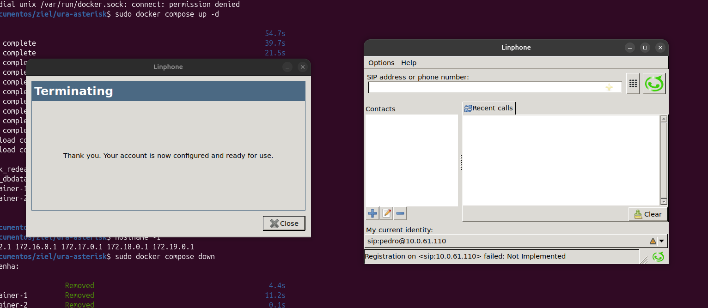
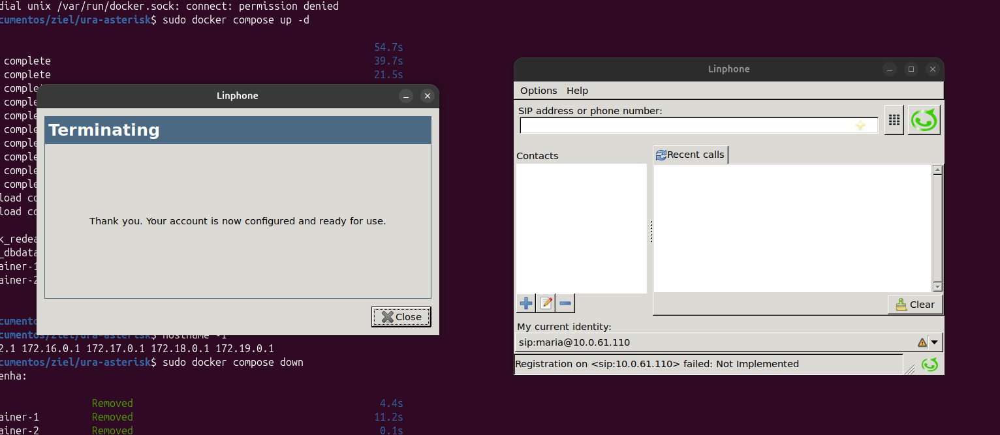
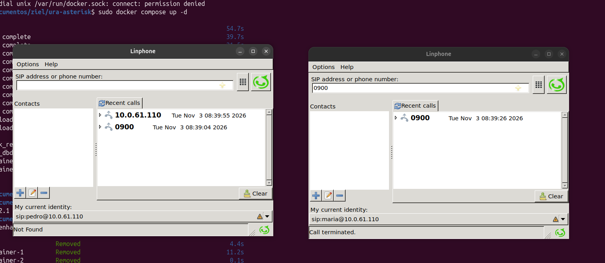
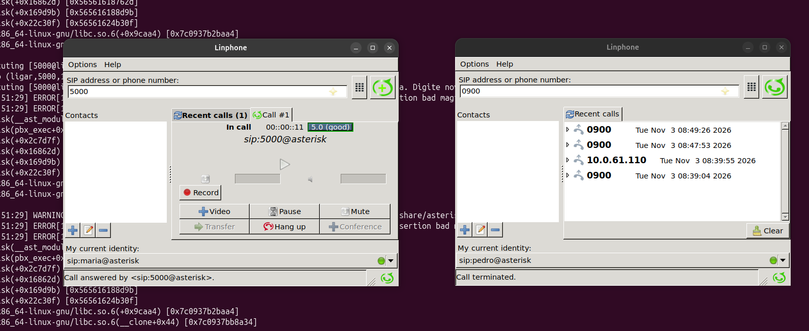

# Tutorial: URA com Asterisk, Google TTS e MySQL via Docker Compose

**IFPB – Instituto Federal da Paraíba**
**Disciplina:** Redes Convergentes | **Docente:** Luciana Pereira Oliveira
**Aluno(a):** Jaaziel Batista da Silva  | João Pessoa – 2025

Este tutorial mostra, passo a passo, como implementei uma URA que atende no ramal **5000**, pede a matrícula do aluno por teclado, consulta o MySQL e responde por voz (Google TTS). Tudo roda em contêineres Docker.

**Ambiente usado:** Linux, Docker Engine 20.10+, Docker Compose 2.x, internet (para o Google TTS), X11 e PulseAudio ativos (para o Linphone).

---

## Passo 1 – Criar a pasta e os arquivos do projeto

```bash
mkdir -p ura-asterisk/agi-bin
cd ura-asterisk
```

### 1.1 `docker-compose.yaml`

```yaml
services:
  voip-container-1:
    image: judavalente/linphone
    container_name: voip-container-1
    environment:
      - DISPLAY=${DISPLAY}
      - PULSE_SERVER=unix:/run/user/1000/pulse/native
    volumes:
      - /tmp/.X11-unix:/tmp/.X11-unix
      - /run/user/1000/pulse:/run/user/1000/pulse
    devices:
      - /dev/snd:/dev/snd
    ports:
      - "5060:5060/udp"
      - "7076-7100:7076-7100/udp"   # RTP do softphone 1
    networks:
      - redeasterisk

  voip-container-2:
    image: judavalente/linphone
    container_name: voip-container-2
    environment:
      - DISPLAY=${DISPLAY}
      - PULSE_SERVER=unix:/run/user/1000/pulse/native
    volumes:
      - /tmp/.X11-unix:/tmp/.X11-unix
      - /run/user/1000/pulse:/run/user/1000/pulse
    devices:
      - /dev/snd:/dev/snd
    ports:
      - "5061:5060/udp"
      - "7101-7125:7101-7125/udp"   # RTP do softphone 2 (faixa diferente)
    networks:
      - redeasterisk

  asterisk:
    image: judavalente/asterisk
    container_name: asterisk
    depends_on:
      - db
    volumes:
      - ./sip.conf:/etc/asterisk/sip.conf
      - ./extensions.conf:/etc/asterisk/extensions.conf
      - ./agi-bin:/var/lib/asterisk/agi-bin
    ports:
      - "5063:5060/udp"
      - "10000-10100:10000-10100/udp"   # RTP do Asterisk
    networks:
      - redeasterisk

  db:
    image: mysql:8
    container_name: db
    environment:
      MYSQL_ROOT_PASSWORD: root
      MYSQL_DATABASE: tts
    volumes:
      - dbdata:/var/lib/mysql
      - ./init.sql:/docker-entrypoint-initdb.d/init.sql
    networks:
      - redeasterisk

networks:
  redeasterisk:
    driver: bridge

volumes:
  dbdata:
```

### 1.2 `sip.conf`

```ini
[general]
context=ligar
allowguest=no
udpbind=0.0.0.0:5060
disallow=all
allow=ulaw
allow=alaw

[pedro]
type=friend
host=dynamic
secret=1234
context=ligar
nat=yes
canreinvite=no
disallow=all
allow=ulaw
allow=alaw

[maria]
type=friend
host=dynamic
secret=1234
context=ligar
nat=yes
canreinvite=no
disallow=all
allow=ulaw
allow=alaw
```

### 1.3 `extensions.conf`

```ini
[ligar]

; ---------- Ramais simples ----------
exten => 0800,1,Answer()
 same => n,Dial(SIP/pedro)
 same => n,Hangup()

exten => 0900,1,Answer()
 same => n,Dial(SIP/maria)
 same => n,Hangup()

; ---------- URA ----------
exten => 5000,1,Answer()
 same => n,Wait(1)
 same => n,AGI(googletts.agi,"Seja bem-vindo ao I F P B",pt-BR)
 same => n(ini),AGI(googletts.agi,"Por favor, digite a sua matrícula",pt-BR)
 same => n,Read(MATRICULA,,11,,1,8)
 same => n,AGI(checkmatricula.agi,${MATRICULA})
 same => n,GotoIf($["${MATRICULASTATUS}" = "1"]?ok:err)
 same => n(ok),AGI(googletts.agi,"Olá ${MATRICULAMESSAGE}, escolha uma das opções",pt-BR)
 same => n,MusicOnHold()
 same => n,Hangup()
 same => n(err),AGI(googletts.agi,"Matrícula não encontrada. Digite novamente",pt-BR)
 same => n,Goto(ini)
```

### 1.4 `init.sql`

```sql
USE tts;

CREATE TABLE IF NOT EXISTS cliente (
  id INT UNSIGNED AUTO_INCREMENT PRIMARY KEY,
  matricula VARCHAR(11) NOT NULL,
  nome VARCHAR(100) NOT NULL
) CHARACTER SET utf8mb4;

CREATE INDEX idx_matricula ON cliente (matricula);

INSERT INTO cliente (matricula, nome) VALUES
 ('20251000001', 'Pedro Silva'),
 ('20251000002', 'Maria Souza'),
 ('12345', 'Aluno Teste');
```

### 1.5 `agi-bin/checkmatricula.agi`

```php
#!/usr/bin/php -q
<?php
// AGI: consulta matrícula no MySQL e devolve MATRICULASTATUS / MATRICULAMESSAGE
// Implementação autocontida (fala o protocolo AGI direto por stdin/stdout).
set_time_limit(30);
error_reporting(E_ERROR);

// Lê o ambiente AGI enviado pelo Asterisk (termina em linha vazia)
while (($l = fgets(STDIN)) !== false) {
    if (trim($l) === '') break;
}

function agi($cmd) {
    fwrite(STDOUT, $cmd . "\n");
    fflush(STDOUT);
    return fgets(STDIN);
}

function setvar($nome, $valor) {
    $valor = str_replace(['"', "\\", "\n", "\r"], '', $valor);
    agi('SET VARIABLE ' . $nome . ' "' . $valor . '"');
}

$matricula = isset($argv[1]) ? preg_replace('/\D/', '', $argv[1]) : '';

if ($matricula === '') {
    setvar('MATRICULASTATUS', '0');
    setvar('MATRICULAMESSAGE', 'Matrícula inválida');
    exit(0);
}

$db = @new mysqli('db', 'root', 'root', 'tts');
if ($db->connect_errno) {
    setvar('MATRICULASTATUS', '0');
    setvar('MATRICULAMESSAGE', 'Erro de conexão com o banco');
    exit(0);
}
$db->set_charset('utf8mb4');

// Prepared statement -> protege contra SQL Injection
$stmt = $db->prepare('SELECT nome FROM cliente WHERE matricula = ? LIMIT 1');
$stmt->bind_param('s', $matricula);
$stmt->execute();
$stmt->bind_result($nome);

if ($stmt->fetch()) {
    setvar('MATRICULASTATUS', '1');
    setvar('MATRICULAMESSAGE', $nome);
} else {
    setvar('MATRICULASTATUS', '0');
    setvar('MATRICULAMESSAGE', 'Matrícula não encontrada');
}
$stmt->close();
$db->close();
```

### 1.6 Conferir a estrutura

```bash
tree
```



---

## Passo 2 – Baixar o `googletts.agi` e dar permissão de execução

```bash
curl -fsSL -o agi-bin/googletts.agi https://raw.githubusercontent.com/zaf/asterisk-googletts/master/googletts.agi
chmod +x agi-bin/*.agi
ls -l agi-bin
```



---

## Passo 3 – Subir os contêineres

Libere o X11 para o Docker (necessário para abrir a janela do Linphone) e suba o ambiente:

```bash
xhost +local:docker
docker compose up -d
```



---

## Passo 4 – Verificar se os contêineres estão rodando

```bash
docker compose ps
```

Devem aparecer `voip-container-1`, `voip-container-2`, `asterisk` e `db` em execução.



---

## Passo 5 – Verificar o banco de dados

O `init.sql` cria a tabela `cliente` e insere as matrículas de teste automaticamente. Confira:

```bash
docker compose exec db mysql -uroot -proot tts -e "SELECT * FROM cliente;"
```


> Se a tabela não existir: `docker compose exec -T db mysql -uroot -proot < init.sql`

---

## Passo 6 – Abrir o CLI do Asterisk

Em um terminal separado (deixe aberto até o fim dos testes):

```bash
docker compose exec asterisk asterisk -rvvv
```

Dentro do CLI:

```
sip show peers
```

Os ramais `pedro` e `maria` aparecem ainda como **UNKNOWN/Unmonitored**, pois não foram registrados.


---

## Passo 7 – Registrar os softphones Linphone

Em cada Linphone, crie uma conta SIP:

| Campo | Linphone 1 | Linphone 2 |
|---|---|---|
| Usuário | `pedro` | `maria` |
| Senha | `1234` | `1234` |
| Servidor SIP | `IP-do-host:5063` | `IP-do-host:5063` |
| Transporte | UDP | UDP |

(Use `hostname -I` para descobrir o IP do host.)

Linphone do pedro registrado:


Linphone da maria registrada:


Volte ao CLI do Asterisk e rode `sip show peers` de novo. Os dois ramais devem aparecer como **OK**:


---

## Passo 8 – Testar os ramais simples (0800 e 0900)

No Linphone do **pedro**, disque `0900`: a chamada toca na **maria**. Atenda e confirme o áudio. Depois faça o inverso: da **maria** para `0800`, que toca no **pedro**.


---

## Passo 9 – Testar a URA com matrícula válida

Em qualquer Linphone, disque `5000` e siga o fluxo:

1. Ouça: "Seja bem-vindo ao IFPB";
2. Ouça: "Por favor, digite a sua matrícula";
3. Digite `20251000001` e `#`;
4. Ouça: "Olá, Pedro Silva, escolha uma das opções" e a música em espera.

Softphone durante a chamada:


CLI do Asterisk no mesmo momento (execução dos AGI, `Read`, `GotoIf` e `MusicOnHold`):


---

## Passo 10 – Testar a URA com matrícula inválida

Disque `5000` novamente e digite uma matrícula que não existe (por exemplo `99999999999`). Ouça: "Matrícula não encontrada. Digite novamente". A URA volta a pedir a matrícula.

CLI do Asterisk mostrando o retorno ao início:


---

## Passo 11 – Encerrar o ambiente

```bash
docker compose down
```

(Para apagar também os dados do MySQL: `docker compose down -v`.)


---

## Resumo do funcionamento

```
Usuário disca 5000
   -> Answer()
   -> AGI googletts.agi (saudação e pedido da matrícula)
   -> Read() captura os dígitos DTMF
   -> AGI checkmatricula.agi consulta o MySQL
   -> MATRICULASTATUS = 1 ? "Olá, [nome]" + MusicOnHold()
                         : mensagem de erro + volta ao início
```
